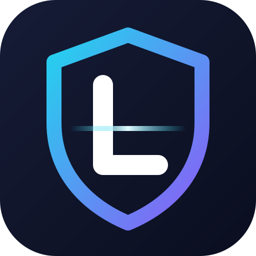

<p align="center">
  
</p>

<h1 align="center">LakuenFileScanner</h1>

<p align="center">
  Fast malware scanner for SteamOS and Linux – files, folders and all subfolders.<br>
  Schneller Malware-Scanner für SteamOS und Linux – Dateien, Ordner und alle Unterordner.
</p>

<p align="center">
  <a href="https://github.com/elkarbeenus/lakuenfilescanner/releases/latest"></a>
  
  
  
</p>

<p align="center"><b>English</b> · <a href="#deutsch">Deutsch</a></p>

---

## English

### Features

- **Files, folders and subfolders** – pick files, whole folders, or just drag & drop them onto the window.
- **Fast on big data** – a private ClamAV daemon loads the signatures into memory once; a multi-threaded scanner feeds it on all CPU cores. Live speed (MB/s, files/s), ETA, pause and cancel.
- **Strong detection** – the ClamAV engine with millions of signatures (updated automatically once a day) plus **Lakuen rules**: double extensions (`invoice.pdf.exe`), right-to-left filename tricks, reverse shells, coin-miner configs, obfuscated shell/PowerShell droppers, `ld.so.preload` rootkit scripts, hidden binaries in `/tmp`.
- **Skips unchanged files** – files that were already clean with the same signature version are not scanned again (optional).
- **You stay in control** – nothing is removed automatically. Per finding: **quarantine** (restorable), **delete** or **ignore** (by SHA-256, survives renaming). Bulk actions included.
- **Quarantine** – files are moved into a private folder, stored encoded so they cannot run, and can be restored at any time.
- **History & reports** – every scan is saved; export reports as HTML, JSON or TXT.
- **Quick scan & self test** – one click for Downloads, autostart, `~/.local/bin`, `/tmp` …; the self test checks detection with the harmless EICAR test file.
- **Modern UI** – six themes (5 dark, 1 light), German and English, keyboard shortcuts, desktop notifications, onboarding on first start.
- **Auto update** – the app checks this repository's releases at start and updates itself with one click (download, SHA-256 check, replace, restart). Your settings, quarantine and signatures are kept.
- **Private** – no account, no telemetry. Only signature updates (ClamAV mirror) and the update check (GitHub) use the network.

### Installation

1. Download `LakuenFileScanner-x86_64.AppImage` from the [latest release](https://github.com/elkarbeenus/lakuenfilescanner/releases/latest).
2. Make it executable: right click → Properties → Permissions → *Is executable*, or:
   ```bash
   chmod +x LakuenFileScanner-x86_64.AppImage
   ```
3. Start it. On first start the app offers to download the signatures (~110 MB).

Updates come from inside the app – no manual download needed again.

### Command line

```bash
./LakuenFileScanner-x86_64.AppImage ~/Downloads /run/media/deck/SD/Games
```

Paths passed as arguments are scanned right away (also works with "Open with" in the file manager).

| Variable | Effect |
|---|---|
| `LAKUEN_NO_UPDATE_CHECK=1` | Disable the app update check (offline use) |
| `LAKUEN_CLAMAV_DIR=/path` | Use another ClamAV build (`bin/clamd`, `bin/freshclam`) |

### Keyboard shortcuts

| Keys | Action |
|---|---|
| `Ctrl` + `O` | Scan files |
| `Ctrl` + `Shift` + `O` | Scan folder |
| `Ctrl` + `Q` | Quick scan |
| `Esc` | Cancel scan |
| `Ctrl` + `,` | Settings |
| `Ctrl` + `1`–`7` | Switch view |

### Where data lives

| What | Path |
|---|---|
| Settings | `~/.config/lakuenfilescanner/` |
| Signatures, quarantine, history | `~/.local/share/lakuenfilescanner/` |

### Building

The AppImage is built by GitHub Actions (`.github/workflows/build.yml`) on Ubuntu 22.04: Tauri 2 builds the app, then the ClamAV engine (clamd + freshclam with their libraries) is added and the AppImage is repacked with zsync update info. A commit on `main` with a new version in `src-tauri/tauri.conf.json` and `[release]` in the commit message publishes that version as a release (pushing a tag `vX.Y.Z` works too).

Local build (needs Rust, Node.js, the Tauri Linux dependencies and `clamav-daemon`):

```bash
npm install
npx tauri build --bundles appimage
```

### Notes

- RAM: with all signatures loaded the engine uses about 1–1.5 GB. You can turn off "Preload engine" in the settings.
- Steam Deck / SteamOS: works in Desktop Mode; the SD card (`/run/media/…`) can be scanned like any folder.

---

## Deutsch

### Funktionen

- **Dateien, Ordner und Unterordner** – Dateien oder ganze Ordner auswählen oder einfach per Drag & Drop ins Fenster ziehen.
- **Schnell bei großen Datenmengen** – ein privater ClamAV-Daemon lädt die Signaturen einmal in den Arbeitsspeicher, ein Multi-Thread-Scanner versorgt ihn auf allen CPU-Kernen. Live-Tempo (MB/s, Dateien/s), Restzeit, Pause und Abbrechen.
- **Starke Erkennung** – ClamAV-Engine mit Millionen Signaturen (automatisch einmal täglich aktualisiert) plus **Lakuen-Regeln**: Doppel-Endungen (`rechnung.pdf.exe`), Rechts-nach-links-Tricks im Dateinamen, Reverse-Shells, Miner-Konfigurationen, verschleierte Shell-/PowerShell-Dropper, `ld.so.preload`-Rootkit-Skripte, versteckte Programme in `/tmp`.
- **Überspringt unveränderte Dateien** – bereits saubere Dateien werden bei gleicher Signatur-Version nicht erneut geprüft (optional).
- **Du behältst die Kontrolle** – nichts wird automatisch entfernt. Pro Fund: **Quarantäne** (wiederherstellbar), **Löschen** oder **Ignorieren** (per SHA-256, auch nach Umbenennen). Mit Mehrfachauswahl.
- **Quarantäne** – Dateien werden in einen privaten Ordner verschoben, kodiert abgelegt (nicht ausführbar) und lassen sich jederzeit wiederherstellen.
- **Verlauf & Berichte** – jeder Scan wird gespeichert, Berichte als HTML, JSON oder TXT exportierbar.
- **Schnellscan & Selbsttest** – ein Klick für Downloads, Autostart, `~/.local/bin`, `/tmp` …; der Selbsttest prüft die Erkennung mit der harmlosen EICAR-Testdatei.
- **Moderne Oberfläche** – sechs Designs (5 dunkel, 1 hell), Deutsch und Englisch, Tastenkürzel, Desktop-Benachrichtigungen, Einführung beim ersten Start.
- **Auto-Update** – die App prüft beim Start die Releases dieses Repos und aktualisiert sich mit einem Klick (Download, SHA-256-Prüfung, Austausch, Neustart). Einstellungen, Quarantäne und Signaturen bleiben erhalten.
- **Privat** – kein Konto, keine Telemetrie. Nur Signatur-Updates (ClamAV-Mirror) und die Update-Prüfung (GitHub) gehen ins Netz.

### Installation

1. `LakuenFileScanner-x86_64.AppImage` aus dem [neuesten Release](https://github.com/elkarbeenus/lakuenfilescanner/releases/latest) herunterladen.
2. Ausführbar machen: Rechtsklick → Eigenschaften → Berechtigungen → *Ausführbar*, oder:
   ```bash
   chmod +x LakuenFileScanner-x86_64.AppImage
   ```
3. Starten. Beim ersten Start bietet die App an, die Signaturen herunterzuladen (~110 MB).

Updates kommen danach direkt aus der App – kein manueller Download mehr nötig.

### Kommandozeile

```bash
./LakuenFileScanner-x86_64.AppImage ~/Downloads /run/media/deck/SD/Games
```

Übergebene Pfade werden sofort gescannt (funktioniert auch über „Öffnen mit“ im Dateimanager).

| Variable | Wirkung |
|---|---|
| `LAKUEN_NO_UPDATE_CHECK=1` | App-Update-Prüfung abschalten (Offline-Betrieb) |
| `LAKUEN_CLAMAV_DIR=/pfad` | Anderen ClamAV-Build verwenden (`bin/clamd`, `bin/freshclam`) |

### Tastenkürzel

| Tasten | Aktion |
|---|---|
| `Strg` + `O` | Dateien scannen |
| `Strg` + `Umschalt` + `O` | Ordner scannen |
| `Strg` + `Q` | Schnellscan |
| `Esc` | Scan abbrechen |
| `Strg` + `,` | Einstellungen |
| `Strg` + `1`–`7` | Ansicht wechseln |

### Wo die Daten liegen

| Was | Pfad |
|---|---|
| Einstellungen | `~/.config/lakuenfilescanner/` |
| Signaturen, Quarantäne, Verlauf | `~/.local/share/lakuenfilescanner/` |

### Bauen

Die AppImage wird von GitHub Actions (`.github/workflows/build.yml`) auf Ubuntu 22.04 gebaut: Tauri 2 baut die App, danach wird die ClamAV-Engine (clamd + freshclam samt Bibliotheken) hinzugefügt und die AppImage mit zsync-Update-Info neu gepackt. Ein Commit auf `main` mit neuer Version in `src-tauri/tauri.conf.json` und `[release]` in der Commit-Nachricht veröffentlicht diese Version als Release (ein Tag `vX.Y.Z` geht auch).

Lokal bauen (benötigt Rust, Node.js, die Tauri-Linux-Abhängigkeiten und `clamav-daemon`):

```bash
npm install
npx tauri build --bundles appimage
```

### Hinweise

- RAM: Mit allen Signaturen belegt die Engine ca. 1–1,5 GB. „Engine beim Start vorladen“ lässt sich in den Einstellungen abschalten.
- Steam Deck / SteamOS: läuft im Desktop-Modus; die SD-Karte (`/run/media/…`) lässt sich wie jeder Ordner scannen.

---

## License / Lizenz

LakuenFileScanner is released under the [MIT license](LICENSE). The AppImage bundles the ClamAV® engine by Cisco Talos, licensed under GPLv2 – see [THIRD_PARTY_NOTICES.md](THIRD_PARTY_NOTICES.md).

LakuenFileScanner steht unter der [MIT-Lizenz](LICENSE). Die AppImage enthält die ClamAV®-Engine von Cisco Talos unter GPLv2 – siehe [THIRD_PARTY_NOTICES.md](THIRD_PARTY_NOTICES.md).

<p align="center"><i>erstellt von Dominic Lesina x Claude</i></p>
